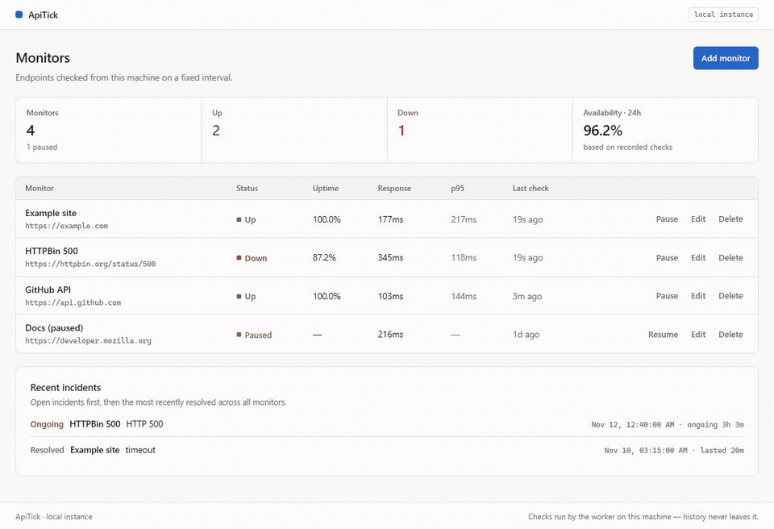
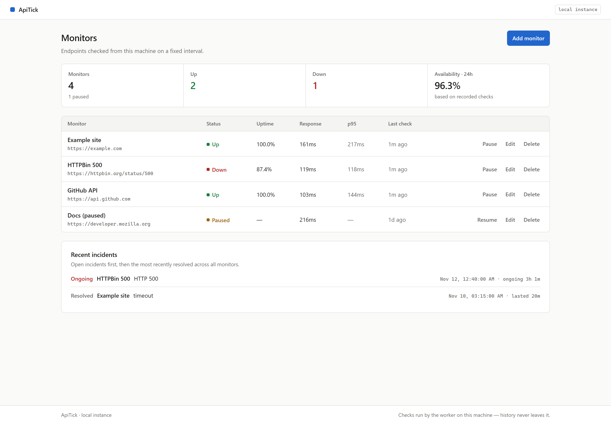
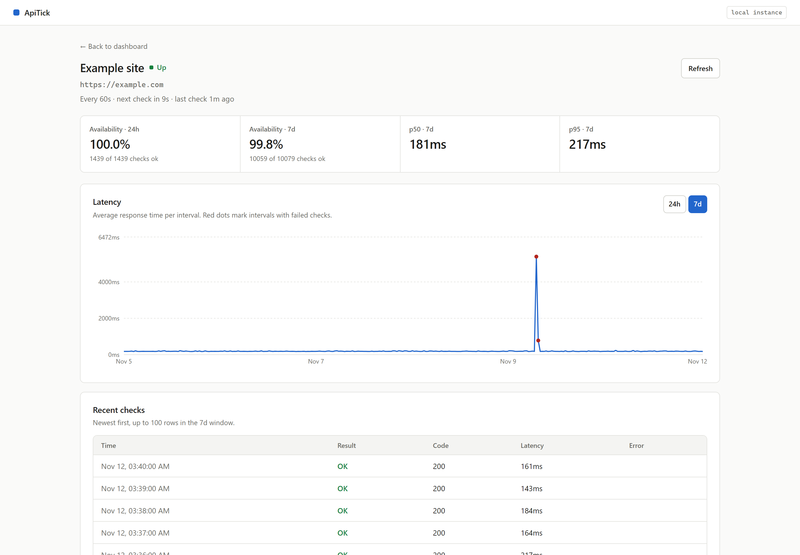

# ApiTick

[Project page](https://chedi-dabbebi.github.io/ApiTick/)

A self-hosted uptime monitor. Add a URL, a background worker probes it on a
schedule, and every result is stored in SQLite. The dashboard shows what is up
right now; each monitor has a detail page with availability, latency
percentiles, a response-time chart, recent checks and incident history.

Built with **React + TypeScript** on the front and **FastAPI + SQLAlchemy** on
the back. No Docker, external services, or API keys are required; it runs on
your machine.



The clip shows the local app adding a monitor, pausing and resuming it,
recording an outage, and resolving the incident after recovery.





## Features

- Add, edit, pause, resume and delete monitors
- Automatic checks on a per-monitor interval (10s minimum)
- Optional body assertion: require a substring in the response (e.g. `"status":"ok"`)
- Uptime and latency history with p50 / p95
- Incidents open on the first failure and resolve automatically on recovery
- Fleet dashboard: up/down/paused counts, 24h availability, and a cross-monitor
  recent-incidents feed
- Detail page: 24h and 7d availability, bucketed latency chart, 100 recent
  checks, incident history
- Single SQLite file; no server to install

## Stack

| Layer | Choice |
|---|---|
| Frontend | React 19, TypeScript, Vite, Recharts, React Router |
| Backend | FastAPI, SQLAlchemy 2, Pydantic 2 |
| Database | SQLite (WAL mode) |
| Checker | httpx + an asyncio worker process |
| Tests | pytest + pytest-asyncio, 105 tests |

## Quick start

Requires **Python 3.12+** (developed on 3.13) and **Node 20+**.

### 1. Backend API

```powershell
cd backend
python -m venv .venv
.venv\Scripts\activate          # macOS/Linux: source .venv/bin/activate
pip install -r requirements.txt
python -m uvicorn app.main:app --reload
```

API: <http://127.0.0.1:8000> — interactive docs at `/docs`.

### 2. Worker

The worker is a separate process, so a slow endpoint can never block the API.

```powershell
cd backend
.venv\Scripts\activate
python -m app.worker
```

`python -m app.worker --once` runs a single tick and exits, which is handy for
manual checks and cron-style deploys.

### 3. Frontend

```powershell
cd frontend
npm install
npm run dev
```

UI: <http://localhost:5173>. Vite proxies `/api` to the backend, so there is no
CORS configuration in development.

### Demo data

The app starts empty. To get a populated dashboard without waiting days for
history to accumulate:

```powershell
cd backend
.venv\Scripts\activate
python scripts/seed_demo.py
```

This writes four monitors and seven days of generated checks (a healthy
service, a recovered outage, an ongoing failure and a paused monitor). It uses
no network access and a fixed RNG seed, so every machine gets the same chart.
Re-run with `--reset` to delete and rebuild the demo monitors; your own
monitors are left alone.

## How a check is judged

- Only `http://` and `https://` URLs are accepted.
- **Any 2xx or 3xx response is up.** 4xx and 5xx are down.
- A monitor may also require a substring in the response body (first 64 kB).
  A 2xx response without that text is down, with the assertion in the error.
- Timeouts and network errors are down, and the error message is stored.
- Redirects are **not** followed (the 3xx itself counts as up). This also
  removes the easiest redirect-based SSRF variant.
- Timeouts: 10s total, 5s to connect.
- The first failure opens an incident; the next success resolves it. A partial
  unique index (`WHERE resolved_at IS NULL`) makes it impossible to have two
  open incidents for one monitor.
- Checks older than 7 days are pruned by the worker once an hour.

### SSRF guard

Monitors can only target public IP addresses. The URL is validated on create
and update, and again before every probe: the hostname is resolved and every
returned address must be globally routable. Loopback, private, link-local,
multicast, reserved and unspecified ranges are rejected.

Known limitation: the guard resolves DNS and httpx resolves it again, so a
hostile resolver could in theory rebind between the two lookups. Fixing that
properly means pinning the resolved IP and setting the `Host` header, which is
more machinery than a single-user local tool needs. Redirects being disabled
closes the easier version of the attack.

## Architecture

```text
┌──────────────────────────┐
│ React + Vite  :5173      │
│  dashboard / detail      │
└────────────┬─────────────┘
             │ /api (dev proxy)
             ▼
┌──────────────────────────┐        ┌────────────────────┐
│ FastAPI  :8000           │◄──────►│ SQLite (WAL)       │
│  REST + aggregation      │        │ monitors / checks  │
└────────────▲─────────────┘        │ incidents          │
             │                      └────────▲───────────┘
             │                               │
┌────────────┴─────────────┐                 │
│ asyncio worker           │─────────────────┘
│  python -m app.worker    │
└────────────┬─────────────┘
             │ httpx (concurrency 10)
             ▼
      monitored URLs
```

- API and worker are separate processes sharing one SQLite file. WAL mode keeps
  readers from blocking the writer, and a busy timeout avoids spurious
  "database is locked" errors.
- `monitors.next_check_at` is denormalised so the worker finds due monitors with
  one indexed `SELECT` per tick instead of computing schedules per row.
- No APScheduler: a ~15-line asyncio loop is enough, and it avoids a second
  scheduler accidentally running under `uvicorn --reload`.
- Status and incident transitions live in `monitor_logic.apply_result()`. It
  imports no FastAPI or scheduler code, so the interesting logic is tested in
  under a second with no network.
- Dashboard aggregation happens in Python. A 7-day window is a few thousand
  rows and SQLite has no percentile function.
- The latency chart is bucketed server-side. A 7-day window at a 60s interval
  is 10,080 checks; the `/series` endpoint returns at most 300 points, each
  with an average and a failure count, so failures are never lost and the
  browser never downloads the raw history.

## API

| Method | Path | Description |
|---|---|---|
| GET | `/api/health` | Liveness |
| GET | `/api/dashboard/summary?window_hours=` | Fleet counts, availability, per-monitor rows |
| GET | `/api/dashboard/incidents?limit=` | Cross-monitor feed: open first, then newest |
| GET | `/api/monitors` | List monitors |
| POST | `/api/monitors` | Create (validates the URL) |
| GET | `/api/monitors/{id}` | One monitor |
| PATCH | `/api/monitors/{id}` | Rename, change URL, interval or body assertion |
| DELETE | `/api/monitors/{id}` | Delete (checks and incidents cascade) |
| POST | `/api/monitors/{id}/pause` | Stop checking |
| POST | `/api/monitors/{id}/resume` | Resume and check immediately |
| GET | `/api/monitors/{id}/checks?limit=&since=` | Raw check history |
| GET | `/api/monitors/{id}/incidents` | Open first, then resolved |
| GET | `/api/monitors/{id}/stats?window_hours=` | Availability, p50, p95 |
| GET | `/api/monitors/{id}/series?window_hours=&max_points=` | Bucketed chart points |

All timestamps in the API are epoch milliseconds (UTC). The UI formats them
locally.

## Tests

```powershell
cd backend
.venv\Scripts\activate
python -m pytest -q
# 105 passed
```

The suite covers the checker and SSRF guard (with a mocked transport), body
assertions, the incident state machine, the partial unique index, CRUD
ownership, the worker's due selection and retention, every endpoint, the
aggregation/percentile math, and the small `init_db` column migration. Tests
run offline against in-memory SQLite.

Frontend checks:

```powershell
cd frontend
npm run lint     # oxlint
npm run build    # tsc -b && vite build
```

## Project layout

```text
ApiTick/
├─ backend/
│  ├─ app/
│  │  ├─ checker.py          SSRF guard + one HTTP probe
│  │  ├─ monitor_logic.py    status and incident transitions
│  │  ├─ crud.py             queries, dashboard aggregates, chart series
│  │  ├─ worker.py           asyncio tick loop (+ --once)
│  │  ├─ main.py             FastAPI app
│  │  └─ routes/             /api/monitors and /api/dashboard
│  ├─ scripts/seed_demo.py   deterministic demo data
│  └─ tests/                 105 tests
├─ frontend/
│  └─ src/
│     ├─ pages/              Dashboard, MonitorDetail
│     ├─ components/         table, form, metric strip, incidents, status badge
│     ├─ api/                typed fetch client
│     ├─ hooks/usePolling.ts polling with abort + restart key
│     └─ index.css           the entire theme, one file
├─ landing/                   static project page and local assets
├─ .github/workflows/         GitHub Pages deployment
└─ docs/                     screenshots
```

## Design notes

- **Epoch-millisecond integers** for every timestamp. SQLite has no timezone
  type, so integers avoid parsing and comparison bugs; ISO strings are produced
  only at the API boundary.
- **One open incident per monitor** is enforced by a partial unique index, not
  application code.
- **The detail route is lazy-loaded.** Recharts is ~370 kB; the dashboard bundle
  stays at ~270 kB and the chart only loads when a monitor is opened.
- **`usePolling` holds the fetcher in a ref** so inline arrow functions don't
  restart the interval, and a `restartKey` refetches immediately when the 24h /
  7d toggle changes.
- **All styling is in `src/index.css`.** No CSS framework and no CSS-in-JS. The
  palette, spacing and type scale are CSS custom properties at the top of the
  file, so the theme can be re-tuned without touching a component.

### UI design notes

The interface is deliberately a light, dense console rather than a marketing
dashboard:

- **One accent (`#2266cc`) for actions and focus.** Green, red and amber are
  reserved for status, so color always means the same thing.
- **Hairlines, not shadows.** Surfaces are flat white on an off-white page;
  depth comes from 1px borders. The only shadow is the dialog.
- **A metric strip, not four cards.** Overview numbers share one divided row,
  6–8px radii, and 40px table rows to keep more data on screen.
- **Monospace for machine data.** URLs, timestamps and tooltips use the system
  mono stack; a system sans stack sets everything else. No webfonts are
  downloaded, so the app stays local-only and paints instantly.
- **Status is a square and a word,** not a glowing pill, and the chart uses a
  linear line because sampled intervals are not a smooth curve.

## Project site

The static project page lives in `landing/`. The workflow in
`.github/workflows/pages.yml` publishes it when files in `landing/` change on
`main`. Set the repository's Pages source to **GitHub Actions**.

## Limitations and next steps

- **Single user, no authentication.** `user_id` is already in the schema and
  every query is scoped to it, so adding JWT auth needs no migration.
- **SQLite only.** Fine for a local instance; a hosted multi-tenant version
  would move to Postgres.
- **No notifications yet.** The incident table is the obvious hook for a
  webhook or email notifier.
- **7-day retention** is deliberate for a small local database.
